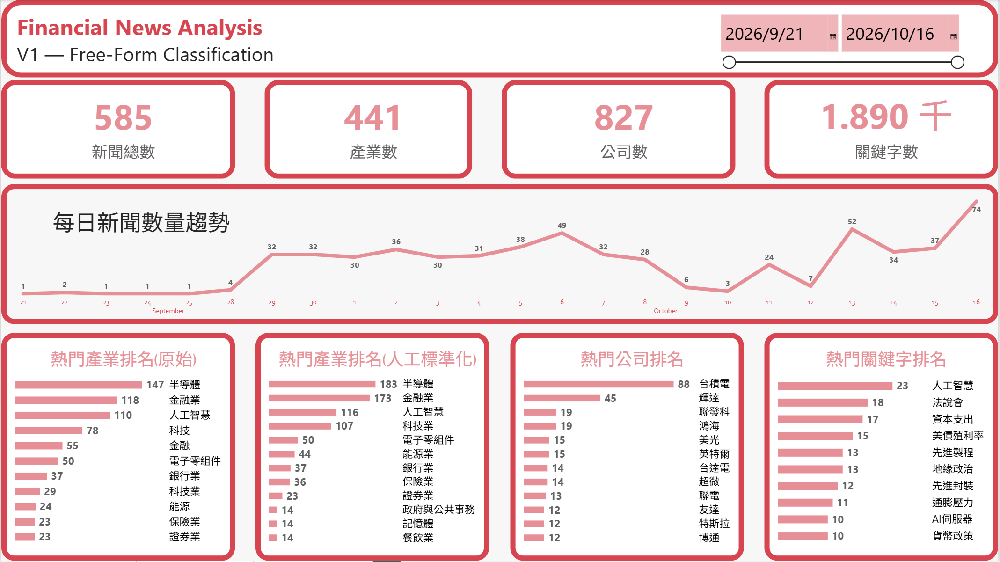
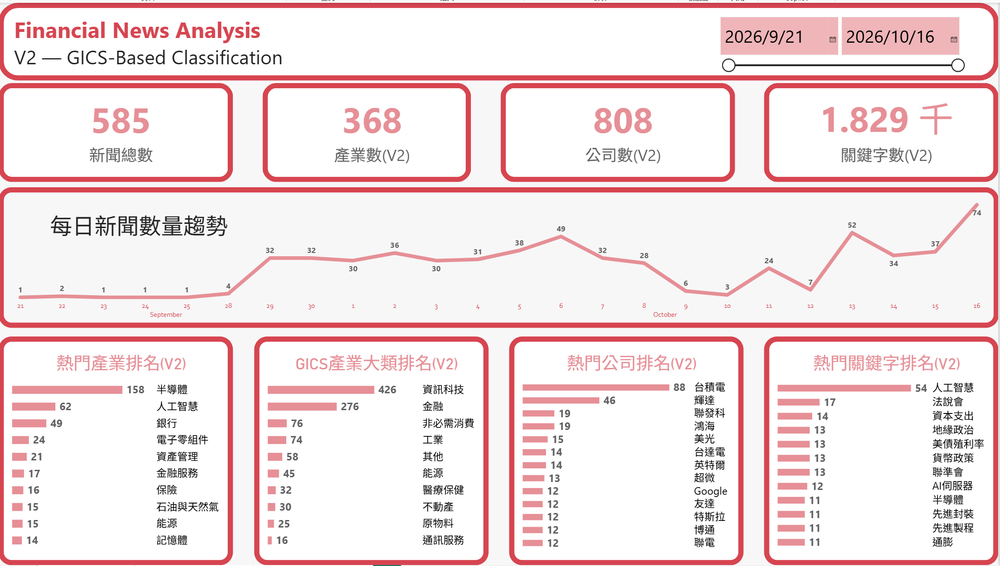
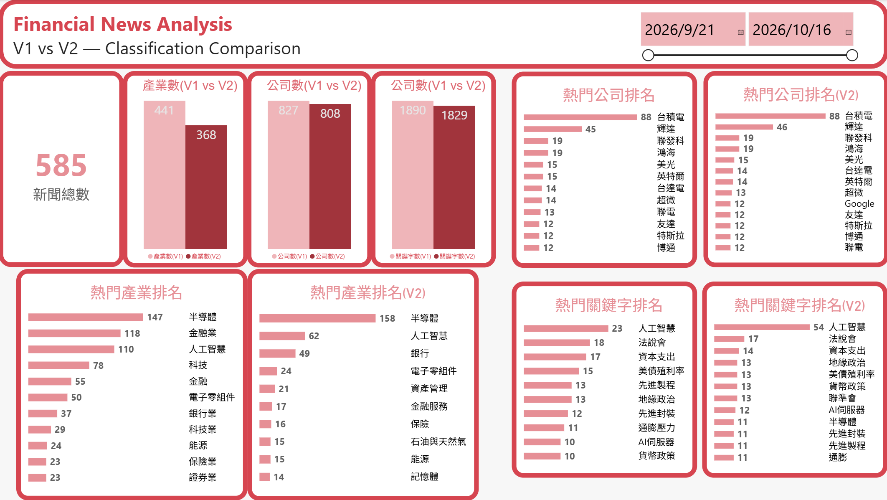

# 04. Financial News Analysis with LLM

## 專案說明

本專案使用 Python 蒐集公開財經新聞，將新聞標題、內容與發布時間儲存至 MySQL，再利用 Google Gemini LLM 將非結構化新聞文字轉換為可分析的產業、公司與關鍵字資料，最後使用 Power BI 進行視覺化分析。

一般新聞資料主要以文字呈現，雖然可以閱讀個別新聞，但不容易直接統計不同產業、公司及議題的出現頻率。

因此這次希望建立一套完整的資料處理流程：

**網頁爬蟲 → MySQL → LLM 分類 → 資料標準化 → Power BI**

本專案除了分析財經新聞，也比較兩種 LLM 產業分類方式：

- **V1：Free-Form Classification**，由 LLM 自由產生產業名稱。
- **V2：GICS-Based Classification**，使用固定的 GICS 產業大分類，同時保留細分產業名稱。

另外，針對 V1 的部分產業名稱進行人工標準化，觀察分類名稱不一致對統計結果的影響。

本專案主要目的是：

> **將非結構化新聞轉換為可查詢、可統計、可視覺化的資料，並比較不同分類設計對分析結果的影響。**

---

## 資料來源

資料來源：聯合新聞網經濟日報公開財經新聞頁面（money.udn.com）。

使用 Python 網頁爬蟲蒐集新聞資料。

資料內容：

- 新聞筆數：585 篇
- 新聞發布期間：2026/09/21～2026/10/16
- 新聞標題（title）
- 發布時間（published_at）
- 新聞網址（url）
- 新聞內容（content）
- 新聞來源（source）

資料儲存於 MySQL 的 `raw_news` 資料表。

爬蟲蒐集的新聞先進行基本清理與網址去重，再提供後續 LLM 分析使用。

本專案以固定的 585 篇新聞作為 V1 與 V2 的共同分析資料，避免因新聞樣本不同而影響版本比較。

---

## 專案目標

這次主要分成三個方向。

### 1. 建立新聞資料分析流程

將公開網站的新聞資料蒐集至 MySQL，並透過 Python 與 LLM 進行資料處理。

目標是將原本難以直接統計的文字資料，轉換為可以使用 SQL 查詢及 Power BI 分析的結構化資料。

### 2. 比較 LLM 產業分類方式

V1 由 LLM 自由判斷產業名稱，分類彈性較高，但可能出現相近名稱。

例如：

- 金融、金融業
- 科技、科技業
- 半導體、半導體產業、半導體業

V2 則使用 GICS 產業大分類，讓每個細分產業都對應一個固定的大分類。

希望比較兩種設計在分類名稱數量、產業統計及後續分析上的差異。

### 3. 觀察人工標準化的效果

針對 V1 部分相近或可整併的產業名稱，使用 Python Mapping 建立標準化欄位。

保留原始 LLM 分類結果，並比較標準化前後的產業排名。

---

## 分析流程

### 1. 網頁爬蟲與資料整理

使用 Python 蒐集財經新聞，取得新聞標題、時間、網址與內容。

主要處理：

- 擷取新聞資料
- 清理新聞內容
- 整理新聞網址
- 排除重複網址
- 將資料寫入 MySQL

原始新聞資料儲存於 `raw_news`。

後續 LLM 分析直接讀取 MySQL 資料，不需要重新爬取新聞。

### 2. LLM 分類 — V1

使用 Google Gemini 分析新聞標題與內容，擷取三類資訊：

- **Industries**：新聞涉及的產業，可包含多個產業
- **Companies**：新聞提及的企業
- **Keywords**：代表新聞核心事件或議題的關鍵字

使用 Pydantic 定義輸出資料結構，要求 LLM 回傳 JSON 格式。

V1 的產業名稱由 LLM 自由產生，不限制固定分類清單。

分析結果分別儲存於：

- `news_industry`
- `news_company`
- `news_keyword`

這種方式可以保留較多產業描述，但也可能產生相近或不同層級的產業名稱。

### 3. LLM 分類 — V2

V2 延續 V1 的新聞資料與分析方向，但調整產業分類結構。

產業分類改為：

- `sub_industry`：LLM 判斷的細分產業
- `main_industry`：對應的固定 GICS 大分類

GICS 大分類包含：

- 能源
- 原物料
- 工業
- 非必需消費
- 必需消費
- 醫療保健
- 金融
- 資訊科技
- 通訊服務
- 公用事業
- 不動產

另外增加「其他」，處理無法合理歸類的新聞；「其他」不是正式 GICS 產業類別。

程式使用 Python Enum 限制 `main_industry` 的允許值，並透過 Pydantic 定義結構化輸出。

V2 分析結果分別儲存於：

- `news_industry_v2`
- `news_company_v2`
- `news_keyword_v2`

V1 與 V2 使用相同的 585 篇新聞，方便比較不同分類方式的結果。

### 4. 人工產業標準化

V1 使用自由分類，部分相近產業會被 LLM 產生為不同名稱。

因此使用 pandas 的 `map()` 與 `fillna()`，針對部分產業名稱建立人工 Mapping。

例如：

| 原始產業 | 人工標準化 |
|---|---|
| 金融 | 金融業 |
| 科技 | 科技業 |
| 半導體產業 | 半導體 |
| 半導體業 | 半導體 |
| 能源 | 能源業 |
| 人工智慧產業 | 人工智慧 |
| 生技製藥 | 生技醫療 |

未列入 Mapping 的產業保留原始名稱。

標準化結果寫入 `news_industry` 的 `normalized_industry` 欄位，不覆蓋原本的 `industry`。

因此未來若要修改 Mapping 規則，可以重新執行 Python 程式並更新標準化結果，不需要重新呼叫 LLM。

這次 Mapping 除了相近名稱統一，也包含部分較細產業的上層整併，因此不將所有 Mapping 視為完全同義詞。

### 5. Power BI 視覺化

使用 Power BI 建立三個分析頁面：

**Page 1：V1 — Free-Form Classification**

- 新聞數量及每日新聞趨勢
- 產業分類數量
- 公司與關鍵字數量
- 熱門產業排名
- 熱門公司排名
- 熱門關鍵字排名
- 原始與人工標準化產業排名比較

**Page 2：V2 — GICS-Based Classification**

- 新聞數量及每日新聞趨勢
- 細分產業數量
- 公司與關鍵字數量
- 熱門細分產業排名
- GICS 產業大分類分布
- 熱門公司與關鍵字排名

**Page 3：V1 vs V2 — Classification Comparison**

- V1 / V2 產業分類數量比較
- V1 / V2 公司數量比較
- V1 / V2 關鍵字數量比較
- 兩版本熱門產業、公司及關鍵字排名比較

---

## 使用技術

- Python
- Pandas
- SQLAlchemy
- MySQL
- Web Scraping
- Google Gemini API
- Pydantic
- Python Enum
- JSON Structured Output
- SQL 資料查詢與更新
- Data Normalization / Mapping
- Power BI

---

## V1 與 V2 分類結果比較

兩個版本均使用相同的 585 篇新聞。

| 指標 | V1 | V2 |
|---|---:|---:|
| 新聞數量 | 585 | 585 |
| 不同產業名稱數量 | 441 | 368 |
| 不同公司名稱數量 | 827 | 808 |
| 不同關鍵字數量 | 1,890 | 1,829 |

V1 產生 441 種產業名稱，V2 產生 368 種細分產業名稱。

V2 的細分產業名稱數量較少，但不能直接認定 V2 分類更準確，因為兩個版本的 Prompt 與產業分類結構不同。

V2 的主要差異在於增加固定的 GICS 大分類，讓不同細分產業可以進一步彙整到共同的產業層級。

公司與關鍵字的不同名稱數量也有差異，表示即使使用相同新聞，LLM 的輸出仍可能因 Prompt 與 Schema 設計而改變。

---

## 人工標準化結果

針對 V1 部分產業名稱進行人工整併後，熱門產業排名出現以下變化：

| 產業 | 原始名稱計數 | 標準化後計數 |
|---|---:|---:|
| 半導體 | 147 | 183 |
| 金融業 | 118 | 173 |
| 人工智慧 | 110 | 116 |
| 科技業 | 29 | 107 |
| 保險業 | 23 | 36 |

例如原本「科技」與「科技業」分別統計，標準化後統一為「科技業」，因此計數增加。

這表示自由分類的產業名稱可能分散統計結果，透過人工 Mapping 可以將部分相關名稱整併，讓排名更容易觀察。

但標準化也有需要注意的地方：

- 人工 Mapping 依照本次設定的規則處理，並非完整產業分類標準。
- 部分名稱整併後，同一篇新聞可能對應到相同的標準化產業。
- 本次比較保留原始資料列計數方式，沒有額外移除整併後的重複分類紀錄。

因此這部分主要展示資料標準化對分類統計的影響，不將排名變化直接解讀為新聞熱度的實際增加。

---

## 分析結果

### 1. 產業分類方式會影響統計結果

V1 自由分類可以產生較細緻的產業名稱，但相近名稱容易分散。

V2 使用固定 GICS 大分類後，可以直接從較高層級觀察不同產業的新聞分布。

兩種方式各有用途：

- V1 適合保留 LLM 對新聞內容的自由描述。
- V2 適合需要固定產業分類層級的統計分析。

### 2. 人工標準化能改善名稱分散問題

V1 中部分相近產業原本分開計算。

經過 Mapping 後，半導體、金融業及科技業等產業的統計數量出現明顯變化。

這次實作顯示，即使已經使用 LLM 產生結構化資料，後續仍可能需要資料清理與標準化。

### 3. LLM 分類結果仍需要驗證

V1 與 V2 的產業、公司及關鍵字數量存在差異，但本專案沒有建立人工標註的標準答案，因此無法直接計算分類 Accuracy、Precision 或 Recall。

目前比較的重點是分類結構、名稱一致性及統計結果，而不是判定哪個版本具有較高的分類準確率。

---

## 結論

這次專案從公開財經新聞爬蟲開始，將資料儲存至 MySQL，再透過 Gemini LLM 將非結構化新聞轉換為產業、公司與關鍵字資料，最後使用 Power BI 建立視覺化分析。

與前面幾個主要使用既有結構化資料的專案不同，這次增加了網頁資料蒐集、LLM 資訊擷取及分類結果標準化的流程。

V1 與 V2 的比較顯示，LLM 的分類設計會影響後續的資料結構與統計結果。自由分類保留較多描述彈性，但容易出現名稱不一致；固定大分類則有助於彙整分析，但仍需保留適當的細分資訊。

另外，人工標準化的結果也顯示，**LLM 能將文字轉換為結構化資料，但不代表產出的分類名稱已經完全一致，後續資料清理仍然重要。**

本專案的重點不是建立最準確的新聞分類模型，而是完成一套從資料蒐集、儲存、LLM 分析、標準化到 BI 視覺化的完整流程，並觀察不同分類方式對分析結果的影響。
